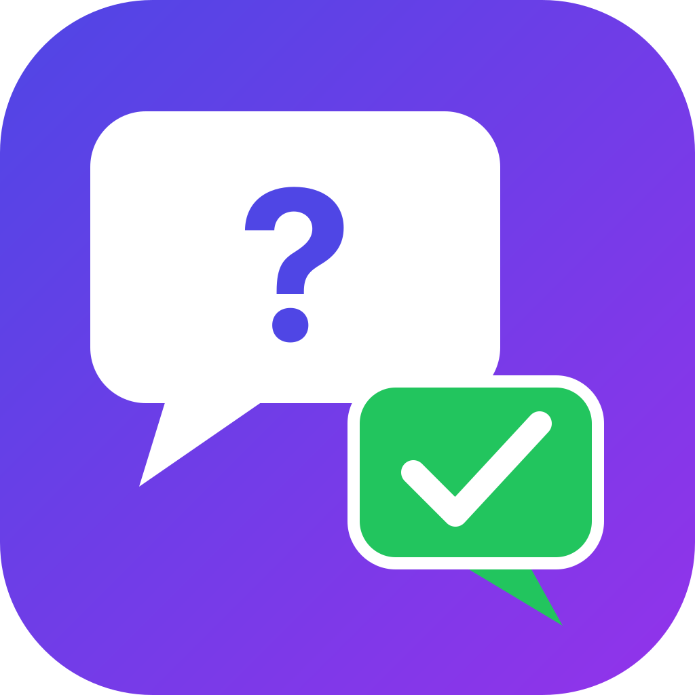
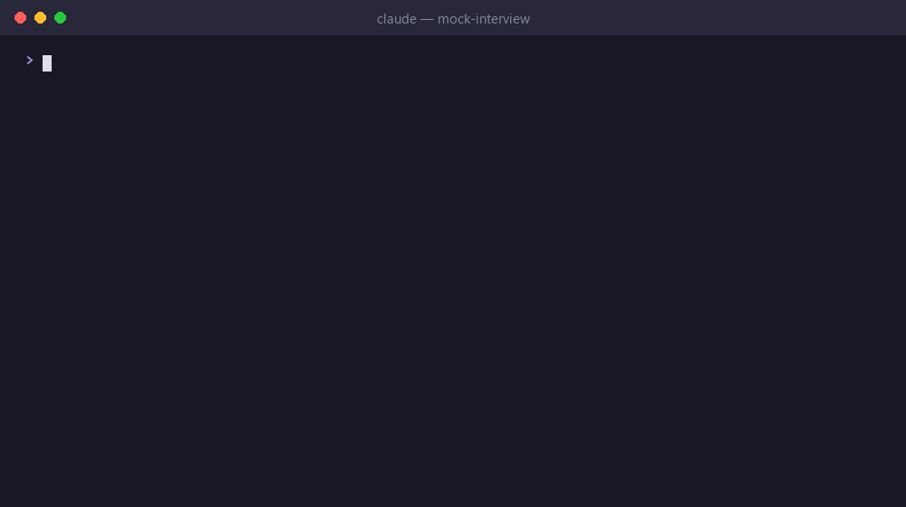

<p align="center">
  
</p>

<h1 align="center">mock-interview</h1>

<p align="center">
  <b>Practice job interviews about <i>your own</i> project, right in Claude Code.</b><br>
  <a href="https://github.com/Aleksa5000/mock-interview/stargazers"></a>
  <a href="LICENSE"></a>
  <a href="https://github.com/Aleksa5000/mock-interview/releases"></a>
</p>

<p align="center">
  
</p>

You built something, maybe with a lot of help from AI. Can you explain it to an interviewer? `mock-interview` reads your project, interviews you like a real hiring manager, scores every answer, shows you a stronger way to say it, and saves a report so you can track your progress.

Made for vibe coders, self-taught developers and anyone preparing for a developer job.

## ✨ What it does

- 🔍 **Reads your project.** It scans the README, manifests, git history and key files, then asks about *your* code ("Walk me through `useCart`", "Why Supabase instead of your own API?"). No project in the folder? It asks for your role and stack and runs a general interview.
- 🎯 **Covers what real interviews ask:**
  - Project deep-dive and "explain this code"
  - **Code & algorithms**: it quotes a snippet from *your* code and asks you to explain it line by line, trace it with an input, give its complexity or find the edge case
  - Technical fundamentals for your stack
  - Debugging scenarios
  - **AI-assisted coding** ("How do you verify code the AI wrote?")
  - System design, scaled to your level
  - Live coding (solved *without* AI)
  - Behavioral questions (STAR)
  - Culture fit and "Do you have questions for us?"
- 🧑‍🏫 **Two modes:**
  - **Practice** gives feedback after every answer.
  - **Realistic** runs without interruptions and gives the full debrief at the end.
- 📝 **Feedback on every answer:**
  - a 1–5 score
  - what was good and what was missing
  - 💬 a **stronger model answer** that uses your real project details
  - one concrete tip
- 📄 **A Markdown report** saved to `interview-reports/` with your overall score, hiring signal, strengths, weak spots and a study plan.
- 🎯 **Interview for a real job ad.** Paste the ad: questions cover every must-have requirement, connect them to your project, and you get a **job match** table (✅ shown / ⚠️ partial / ❌ gap), the 3 things to prepare and a ready "why I'm a good fit" pitch.
- 📈 **Tracks your progress.** It reads your earlier reports, focuses on your weakest categories and shows a before/after table. `/mock-interview retry` re-asks only the questions you scored 3 or less on.
- 🌍 **Speaks your language.** It answers in whatever language you write in. Switch to English mid-interview to practice.
- 🔁 **Notices when you've built something new.** After your first interview in a project, a later session there offers once a short practice round about the new work (5+ new commits). Turn it off with `/mock-interview watch off`.

## 📦 Install

**Option A: as a plugin (recommended, gets updates)**

Inside Claude Code:
```
/plugin marketplace add Aleksa5000/mock-interview
/plugin install mock-interview@mock-interview
```

**Option B: copy the skill manually**
```bash
git clone https://github.com/Aleksa5000/mock-interview.git
# macOS / Linux
cp -r mock-interview/skills/mock-interview ~/.claude/skills/
# Windows (PowerShell)
Copy-Item -Recurse mock-interview\skills\mock-interview $HOME\.claude\skills\
```

Restart Claude Code after installing.

**Option C: Codex** (it reads the same `SKILL.md` format)
```
codex plugin marketplace add Aleksa5000/mock-interview
codex plugin add mock-interview@mock-interview
```
Or copy the folder: `cp -r mock-interview/skills/mock-interview ~/.agents/skills/`. In Codex, run it with `$mock-interview` instead of `/mock-interview`.

## 🔄 Stay up to date

New versions come out often. Turn on automatic updates once, and you'll always have the latest:

**Claude Code** (third-party plugins don't auto-update by default):
- In Claude Code: `/plugin` → **Marketplaces** → **mock-interview** → **Enable auto-update**
- Or add `"autoUpdate": true` to the marketplace in `~/.claude/settings.json`:
  ```json
  "extraKnownMarketplaces": {
    "mock-interview": { "source": { "source": "github", "repo": "Aleksa5000/mock-interview" }, "autoUpdate": true }
  }
  ```
Claude Code then checks for updates in the background and installs them; run `/reload-plugins` or restart to use the new version. To update right away: `claude plugin marketplace update mock-interview` and `claude plugin update mock-interview@mock-interview`.

**Codex** (no automatic plugin updates yet): `codex plugin marketplace upgrade mock-interview`

**Manual copy:** `git pull` in your clone and copy `skills/mock-interview` again.

## 🚀 Usage

Open Claude Code in your project folder and run:
```
/mock-interview
```
(When installed as a plugin, the full name is `/mock-interview:mock-interview`.)

Or just say *"interview me for a junior frontend job"*.

| Command | What you get |
|---|---|
| `/mock-interview` | A full interview about your project |
| `/mock-interview <paste a job ad>` | An interview tailored to that position, with a job match |
| `/mock-interview retry` | Only the questions you did badly on last time |

You will pick:
- your **role and level** (e.g. Junior Full-stack)
- the **mode** (Practice or Realistic)
- the **length**: Quick (~5 questions), Standard (~10) or Full (~15)
- the **focus** areas

During the interview you can type `hint`, `skip`, `pause`, `switch mode` or `end`.

## 👀 Example

```
Question 3/10 · Project deep-dive
In app/api/checkout/route.ts you call Stripe directly from the request handler.
What happens if Stripe is slow or returns an error?

> i think it just shows an error to the user

Score: 2/5 · You noticed the user-facing effect, but not the system behavior.

✅ What was good: You thought about the user experience.
⚠️ What was missing: There's no timeout or retry, the error isn't logged, and if the
   request times out after Stripe charged the card, the order may never be saved.
💬 Stronger answer:
> "Right now the handler awaits Stripe with no timeout, so a slow response blocks the
> request and a failure just bubbles up as a 500. I'd add a timeout and log the error with
> the order ID, and show a clear retry message. More importantly, I'd rely on Stripe
> webhooks as the source of truth, so an order gets marked paid even if the original
> request failed after the charge went through."
💡 Tip: For "what if X fails" questions, cover the user, the data, and how you'd find out.
```

See a full sample report in [`examples/sample-report.md`](examples/sample-report.md).

## ❓ FAQ

**Does it change my code?** No. It only reads your project. The one file it writes is the report in `interview-reports/` (you may want to add that folder to `.gitignore`). If you ask it to change your code mid-interview, it offers to end the interview first, so you don't end up with code you can't explain.

**Does it read my secrets?** No. It skips `.env` files, keys, credentials and databases, and it uses read-only tools to scan the project.

**Can it run my live-coding answer?** Sometimes. If Node or Python is available, it may run your self-contained snippet to confirm a bug, and it tells you when it does.

**Does it run my code?** No. It won't run builds, tests or installs unless you ask.

**Is the score a real hiring prediction?** No. It's a practice estimate to show you what to improve.

**Can I use it without a project?** Yes. It will ask for your role and stack.

## 💬 Feedback

Your feedback decides what gets improved next.
- At the end of each interview, the skill shows a **prefilled feedback link** once. It contains only your role, mode, number of questions and language. **Nothing is sent automatically**: you see the form and choose whether to submit it.
- Or use the [feedback form](https://github.com/Aleksa5000/mock-interview/issues/new?template=feedback.yml) directly.
- Found a bug? [Report it](https://github.com/Aleksa5000/mock-interview/issues/new?template=bug_report.yml).
- Have an idea? [Suggest it](https://github.com/Aleksa5000/mock-interview/issues/new?template=feature_request.yml).
- Questions and results go in [Discussions](https://github.com/Aleksa5000/mock-interview/discussions).

## 🧩 Works great with

**[explain-stack](https://github.com/Aleksa5000/explain-stack)** explains *why* your project uses each technology, with real file references, and `/explain-stack code` walks you through your key code and algorithms line by line. Learn it there first, then practice explaining it here with `/mock-interview` (pick the **Code & algorithms** focus).

## 🤝 Contributing

Ideas, new question categories and translations are welcome. Open an issue or PR.
The skill lives in [`skills/mock-interview/`](skills/mock-interview/):
- `SKILL.md` is the main flow
- `references/` holds the question bank, the scoring rubric, the project analysis steps and the report template

When releasing, bump the version in `.claude-plugin/plugin.json`, in the feedback link in `SKILL.md` (Phase 5), and in `CHANGELOG.md`.

If this helped you prepare, please ⭐ the repo so more people can find it.

## License

[MIT](LICENSE) © Aleksa Djorovic
